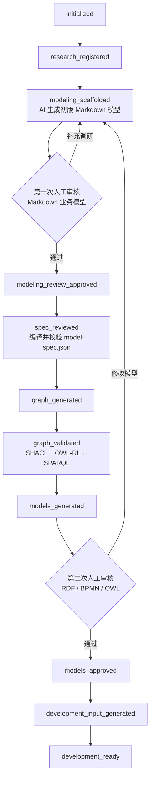

# Research to Project Input — 操作手册

> 本文件是原 `README.md` 的完整操作手册部分，内容未作删减，仅调整了位置。
> 项目概览、架构设计与快速验证请见仓库根目录的 [`README.md`](../README.md)。

将业务调研材料转换为经过人工审核、模型校验和追溯验证的 AI 开发输入。

该 Skill 面向以下工作：

- 整理业务调研文档和调研台账。
- 根据调研材料生成一套人可读的初版 Markdown 业务模型。
- 人工审核初版 Markdown 模型后，再进入机器模型生成。
- 生成统一的 `model-spec.json`。
- 生成统一 RDF 需求图和 PROV-O 来源链。
- 使用 SHACL、SPARQL 和 OWL-RL 推理执行语义门禁。
- 从同一模型源生成 BPMN 2.0 和 OWL 文件。
- 模型审核通过后生成 `docs/input/00-07`。
- 校验流程、实体、状态、规则、能力和证据之间的追溯关系。
- 锁定模型基线，为后续 PRD、Coding Task 和 AI 编码提供输入。

## 1. 核心原则

本 Skill 采用“指令 + 状态机 + 执行器 + Hook + 人工审核”的控制方式：

| 控制层 | 作用 |
|---|---|
| `SKILL.md` | 告诉 AI 必须遵循的工作方式 |
| `pipeline-definition.json` | 定义阶段、转换、审批门禁和不变量 |
| `pipeline-process.bpmn` | 使用中文和完整 BPMN DI 表达流水线顺序及审核回路，可由 Camunda Modeler 打开 |
| `pipeline-ontology.owl` | 表达阶段、动作、产物和审批关系 |
| `pipeline_runner.py` | 执行阶段转换并维护持久化状态 |
| `pipeline_guard.py` | 阻止直接修改受保护产物 |
| 统一需求图 | 将流程、实体、状态、规则、能力、证据和问题连接成 RDF 图 |
| SHACL / SPARQL / 推理 | 执行完整性、追溯性和语义一致性门禁 |
| 校验脚本 | 检查模型、引用、投影、哈希和追溯关系 |
| 人工审核 | 确认业务事实和模型语义 |

重要限制：

- “继续做”“先出草稿”“稍后审核”不等于审批通过。
- 原始调研材料不能直接生成统一需求图、BPMN、OWL 或 `00-07`。
- 初版 Markdown 模型未经人工审核，不得编译正式 `model-spec.json`。
- BPMN 业务名称必须使用中文；OWL 业务类、对象属性、数据属性和命名实例同时使用中文 IRI 局部名及 `zh-CN` 中文标签。
- `entity_id`、`relation_id`、`field_id`、`state_id` 等稳定 ID 保留 ASCII，并写入对应 OWL 资源唯一的 `trace:稳定标识`。
- 项目自定义的对象属性、数据属性、注解属性和流水线弧类型使用中文 IRI；`rdf:type`、`rdfs:subClassOf`、`rdfs:domain/range` 等 W3C 标准 URI 不改名，只补充 `zh-CN` 中文显示标签。
- 所有业务 BPMN 必须包含完整 BPMN DI，并使用 `camunda:properties` 保存追溯信息，确保 Camunda Modeler 可打开且画布可见。
- 统一需求图、BPMN 和 OWL 未人工审核前，不生成任何 `docs/input/00-07`。
- AI 不得代替审核人使用 `--human-confirmed`。
- 不支持 `--allow-unapproved` 旁路。
- 生成文件不能手工修补，必须修改上游模型源后重新生成。

## 2. 流水线阶段



完整产物流为：

```text
原始调研文档
  -> AI 提取并生成 models/review/00-05 初版 Markdown 模型
  -> 第一次人工审核和业务补充
  -> reviewed model-spec.json
  -> 统一 RDF 需求图与 PROV-O 来源链
  -> SHACL、OWL-RL 和 SPARQL 语义验证
  -> 候选 BPMN 与领域 OWL
  -> 第二次人工模型审核
  -> approved model-spec.json
  -> 重新生成批准版统一图、BPMN 与 OWL
  -> docs/input/00-07
  -> 基线锁定和开发就绪校验
```

两次人工审核不能合并：

| 审核门禁 | 审核对象 | 主要目的 |
|---|---|---|
| 第一次：业务建模审核 | `models/review/00-05` 初版 Markdown 模型 | 确认 AI 是否正确理解调研事实、流程、实体、状态、规则和边界 |
| 第二次：正式模型审核 | 统一需求图、验证报告、BPMN、OWL | 确认机器模型是否准确表达已审核的业务模型 |

只有满足以下两个条件，才能进入后续 PRD 和开发：

```text
current_stage = development_ready
valid = true
```

## 3. 输入材料

可以输入一份或多份材料，不要求第一次就完成全部调研：

- AI 调研文档。
- 访谈记录和会议纪要。
- 流程台账。
- SOP 摘要。
- Excel、Word、PPT、PDF 等业务资料。
- 业务边界说明。
- 角色、实体、状态、规则、异常和接口清单。
- 已有 BPMN、Ontology 或领域模型草案。
- 证据文件和待确认问题。

新增调研材料会影响已经审核的模型时，必须通过 `reopen` 回到上游阶段，
重新审核并生成下游产物。

## 4. 输出目录

默认在目标项目中形成以下结构：

```text
<project-root>/
├── .requirements-pipeline/
│   └── pipeline-state.json
├── .codex/
│   ├── hooks.json
│   └── hooks/
│       └── research_pipeline_guard.py
├── models/
│   ├── review/
│   │   ├── 00-建模范围.md
│   │   ├── 01-流程建模台账.md
│   │   ├── 02-领域建模台账.md
│   │   ├── 03-状态与规则台账.md
│   │   ├── 04-接口与消息台账.md
│   │   ├── 05-证据与待确认问题.md
│   │   └── 06-模型审核记录.md
│   ├── spec/
│   │   └── model-spec.json
│   ├── graph/
│   │   ├── requirements-graph.ttl
│   │   ├── requirements-graph-ontology.ttl
│   │   ├── requirements-shapes.ttl
│   │   ├── inferred-graph.ttl
│   │   ├── shacl-report.ttl
│   │   ├── reasoning-report.json
│   │   ├── sparql-results.json
│   │   ├── graph-validation-report.json
│   │   └── queries/
│   │       ├── query-manifest.json
│   │       └── *.rq
│   ├── bpmn/
│   │   └── <process_id>.bpmn
│   ├── ontology/
│   │   └── <ontology_id>.owl
│   └── baseline-manifest.json
└── docs/
    └── input/
        ├── 00-项目概述.md
        ├── 01-能力目录.md
        ├── 02-领域模型.md
        ├── 03-状态机.md
        ├── 04-业务规则.md
        ├── 05-流程模型.md
        ├── 06-调研台账摘要.md
        └── 07-待确认问题.md
```

## 5. 使用前提

- Codex 已安装本 Skill。
- 可使用 Python 3.10 或更高版本。
- 目标项目目录可写。
- 项目级 Codex Hook 已经过用户检查和信任。

Skill 安装目录：

```text
<本 Skill 的安装目录>\research-to-project-input
```

## 6. 推荐使用方式

在 Codex 中明确调用：

```text
$research-to-project-input
```

示例请求：

```text
使用 $research-to-project-input，将这些调研材料纳入需求流水线。
先检查当前状态，只执行允许的下一阶段，不要跨过人工审核门禁。
```

AI 每次恢复任务时，应先执行：

```powershell
python "<skill>\scripts\pipeline_runner.py" --project-root "<project-root>" status
python "<skill>\scripts\pipeline_runner.py" --project-root "<project-root>" next
```

## 7. 首次初始化

```powershell
python "<skill>\scripts\pipeline_runner.py" `
  --project-root "<project-root>" `
  init
```

`init` 默认完成：

- 创建 `.requirements-pipeline/pipeline-state.json`。
- 校验控制 JSON、控制 BPMN、流水线 OWL 和状态模板的一致性。
- 安装项目级 `PreToolUse` 和 `Stop` Hook。

Codex 会要求检查并信任新增 Hook。Hook 未受信任前，Runner 仍可工作，
但不能依赖 Hook 阻止 AI 直接写入文件。

登记调研文件：

```powershell
python "<skill>\scripts\pipeline_runner.py" `
  --project-root "<project-root>" `
  register-research `
  --file "<research-file-1>" `
  --file "<research-file-2>"
```

## 8. 执行自动阶段

查询当前唯一允许的动作：

```powershell
python "<skill>\scripts\pipeline_runner.py" `
  --project-root "<project-root>" `
  next
```

执行当前自动阶段：

```powershell
python "<skill>\scripts\pipeline_runner.py" `
  --project-root "<project-root>" `
  run-stage
```

验证当前状态：

```powershell
python "<skill>\scripts\pipeline_runner.py" `
  --project-root "<project-root>" `
  validate
```

`run-stage` 不会自动跨过人工审核点。

## 9. 建模 Markdown 人工审核

登记调研材料后，AI 必须先根据材料填写
`models/review/00-05`，形成初版 Markdown 业务模型。它是供业务人员阅读、
补充和确认的建模基线，不是简单的调研摘要，也不是功能清单。

初版模型包括：

| 文件 | 内容 |
|---|---|
| `00-建模范围.md` | 项目边界、阶段范围、系统责任和外部参与方 |
| `01-流程建模台账.md` | 场景、流程节点、角色、输入输出、异常和证据 |
| `02-领域建模台账.md` | 实体、属性、关系、基数、术语和证据 |
| `03-状态与规则台账.md` | 状态迁移、触发事件、守卫条件和业务规则 |
| `04-接口与消息台账.md` | 软件接口、消息方向、字段、触发和失败处理 |
| `05-证据与待确认问题.md` | 来源证据、AI 推断、待确认问题和阻塞级别 |

AI 完成这些文件后，人工检查：

- 项目范围是否准确。
- 流程顺序和角色是否准确。
- 网关条件和异常分支是否完整。
- 实体、关系和基数是否准确。
- 状态流转和业务规则是否完整。
- 接口方向、触发方式和失败处理是否明确。
- 每项事实是否有证据或待确认问题。

确认通过后执行：

```powershell
python "<skill>\scripts\pipeline_runner.py" `
  --project-root "<project-root>" `
  approve `
  --gate modeling `
  --reviewer "<审核人>" `
  --review-date "YYYY-MM-DD" `
  --note "<审核结论和批准范围>" `
  --human-confirmed
```

只有用户明确完成审核后，AI 才能执行该命令。

第一次审核通过前，流水线必须停在 `modeling_scaffolded`。不得提前生成
`model-spec.json`、统一需求图、BPMN、OWL 或 `docs/input/00-07`。

## 10. 统一需求图、BPMN 和 OWL 人工审核

候选图模型、BPMN 和 OWL 生成后，人工检查：

- BPMN 流程、参与方、泳道、任务、事件、网关、顺序流和消息流是否使用中文业务名称。
- BPMN 在 Camunda Modeler 中是否能够打开，所有节点和连线是否可见。
- OWL 本体、类、属性和状态实例是否具有 `xml:lang="zh-CN"` 的中文标签。
- OWL 类、对象属性、数据属性、注解属性和状态实例是否使用中文 IRI 局部名，并且各自只有一个非空、全局唯一的 `trace:稳定标识`。
- 统一需求图是否连通流程、角色、实体、状态、规则、能力、接口、证据和问题。
- PROV-O 是否记录来源证据、生成活动和审核人。
- `shacl-report.ttl` 是否符合，推理报告是否无一致性错误。
- 强制 SPARQL 查询是否通过，复用和影响分析结果是否合理。
- BPMN 起点、终点、任务和网关是否正确。
- 分支条件、退回路径和异常路径是否完整。
- 角色泳道和系统参与方是否准确。
- OWL 类、属性、关系、基数和状态是否准确。
- BPMN、OWL 和建模 Markdown 是否表达同一业务事实。
- 重复流程节点是否正确复用了同一个 `capability_id`。

中文建模不改变技术标识。例如：

| 类型 | XML ID / OWL IRI | 中文业务名称 | 稳定 ID |
|---|---|---|---|
| BPMN 节点 | `ND-IMPORT-TASK` | 导入工单 | XML `id` |
| BPMN 网关 | `GW-TASK-COMPLETE` | 任务数据是否完整 | XML `id` |
| OWL 类 | `#工单` | 工单 | `trace:稳定标识 = ENT-TEST-TASK` |
| OWL 对象属性 | `#工单_产生_处理结果` | 产生 | `trace:稳定标识 = REL-TASK-RESULT` |
| OWL 状态实例 | `#工单_待处理转为处理中_开始处理` | 待处理转为处理中 | `trace:稳定标识 = ST-TASK-START` |

下游 PRD、代码和测试继续引用 `trace:稳定标识` 中的技术标识；界面、图形、业务文档和项目自定义 OWL IRI 使用中文名称。

将结论写入 `models/review/06-模型审核记录.md`，然后执行：

```powershell
python "<skill>\scripts\pipeline_runner.py" `
  --project-root "<project-root>" `
  approve `
  --gate models `
  --reviewer "<审核人>" `
  --review-date "YYYY-MM-DD" `
  --note "<审核结论和批准范围>" `
  --human-confirmed
```

Runner 会：

1. 检查候选统一需求图、验证报告、BPMN 和 OWL 是否发生漂移。
2. 将 `model-spec.json` 状态更新为 `approved`。
3. 记录审核人、日期和结论。
4. 从批准后的模型源重新生成并验证统一需求图、BPMN 和 OWL。

## 11. 受控返工

需要修改已经审核的内容时，不能直接编辑受保护文件。

回到建模 Markdown：

```powershell
python "<skill>\scripts\pipeline_runner.py" `
  --project-root "<project-root>" `
  reopen `
  --to modeling_scaffolded `
  --reason "<变更原因>"
```

回到统一模型源：

```powershell
python "<skill>\scripts\pipeline_runner.py" `
  --project-root "<project-root>" `
  reopen `
  --to modeling_review_approved `
  --reason "<变更原因>"
```

可回退阶段：

| 阶段 | 适用情况 |
|---|---|
| `initialized` | 更换或追加调研来源 |
| `research_registered` | 重新创建建模文档 |
| `modeling_scaffolded` | 修改建模 Markdown 并重新人工审核 |
| `modeling_review_approved` | 重新编制或修改 `model-spec.json` |

下游旧文件会保留用于比较，但在重新生成前都属于过期产物。

## 12. 最终验收

完整生成后执行：

```powershell
python "<skill>\scripts\pipeline_runner.py" `
  --project-root "<project-root>" `
  validate

python "<skill>\scripts\pipeline_runner.py" `
  --project-root "<project-root>" `
  status `
  --json
```

开发就绪要求：

- `current_stage` 为 `development_ready`。
- `valid` 为 `true`。
- 无开放的 High 阻塞问题。
- 统一需求图、BPMN、OWL 和 `00-07` 是当前模型源的精确投影。
- SHACL 符合，OWL-RL 推理无一致性错误，强制 SPARQL 查询全部通过。
- 基线 SHA-256 无漂移。
- 所有关键对象具有证据或待确认问题。
- 流程节点可从开始事件到达，并能够到达结束事件。
- 异常分支在 BPMN 中有真实路径。

## 13. Hook 保护范围

进入相应阶段后，Hook 会阻止直接修改：

- `.requirements-pipeline/pipeline-state.json`
- `models/graph/`
- `models/bpmn/`
- `models/ontology/`
- `models/baseline-manifest.json`
- `docs/input/`
- 已审核的 `models/review/00-06`
- 已校验的 `models/spec/model-spec.json`

`Stop` Hook 会在 AI 准备结束任务时重新检查流水线完整性。发现哈希漂移时，
任务不能被报告为完成。

Hook 是额外防线，不替代 Runner、校验脚本和人工审核。

## 14. 常见问题

### 调研必须全部完成后才能开始吗？

不需要。可以分批调研，但每次增加影响模型的新材料，都需要受控回退、
更新建模文档并重新审核。

### 可以跳过图模型、BPMN 和 OWL 审核，先生成 00-07 吗？

不可以。该 Skill 已删除未审批生成旁路。

### 可以手工修改统一需求图、BPMN、OWL 或 00-07 吗？

不可以。应修改建模 Markdown 或 `model-spec.json`，然后重新生成。

### 多个 BPMN 使用同一个功能会重复开发吗？

不会因为流程重复出现就自动生成多个能力。多个流程节点应引用同一个
`capability_id`，由能力目录统一承载复用能力。

### `docs/input/00-07` 是 PRD 吗？

不是。它们是经过模型审核的开发需求输入，后续 AI 应基于这些文件继续生成
PRD、架构设计、Coding Task、代码和测试。

### Hook 没有运行怎么办？

检查：

1. 项目中是否存在 `.codex/hooks.json`。
2. Codex 是否已信任当前 Hook 定义。
3. Skill 和项目路径是否仍然有效。
4. 必要时执行 `pipeline_runner.py install-hooks`。

## 15. 自测试

```powershell
python "<skill>\scripts\self_test.py"
```

自测试覆盖：

- 阶段状态机。
- 两个人工审批门禁。
- 未审批生成旁路阻断。
- 统一需求图、BPMN、OWL 和 `00-07` 生成。
- PROV-O 来源链、SHACL、SPARQL 和 OWL-RL 推理验证。
- RDF 空白节点规范化与可重复哈希。
- BPMN 中文名称、OWL 中文自定义 IRI、`zh-CN` 标签及 `trace:稳定标识` 的正向与负向门禁。
- 控制 JSON、控制 BPMN、流水线 OWL 和状态模板一致性。
- 追溯关系和语义投影。
- High 阻塞问题。
- 基线哈希和漂移检测。
- `PreToolUse` 和 `Stop` Hook。

预期结果：

```text
PASS self-test: state machine, human gates, hooks, generation,
semantic traceability, High blockers, baseline, and drift detection
```

## 16. 文件职责

| 文件 | 职责 |
|---|---|
| `SKILL.md` | AI 执行规则 |
| `README.md` | 人工使用说明 |
| `references/pipeline-definition.json` | 可执行阶段契约 |
| `references/pipeline-process.bpmn` | Camunda 兼容的中文流水线流程模型 |
| `references/pipeline-ontology.owl` | 流水线语义模型 |
| `references/graph-engineering-contract.md` | 统一需求图及语义验证契约 |
| `assets/requirements-graph-ontology.ttl` | 需求图词汇与 OWL 公理 |
| `assets/requirements-shapes.ttl` | SHACL 约束 |
| `assets/sparql/` | SPARQL 查询和执行清单 |
| `scripts/pipeline_runner.py` | 状态机执行器 |
| `scripts/generate_requirements_graph.py` | 统一需求图生成器 |
| `scripts/validate_graph_engineering.py` | SHACL、SPARQL 和推理门禁 |
| `scripts/pipeline_guard.py` | Codex Hook 守卫 |
| `scripts/validate_pipeline_control.py` | 控制模型一致性校验 |
| `scripts/self_test.py` | 全链路回归测试 |

遇到规则冲突时，以 `SKILL.md`、`pipeline-definition.json` 和
`pipeline_runner.py` 的门禁结果为准，README 仅用于人工理解和操作。
